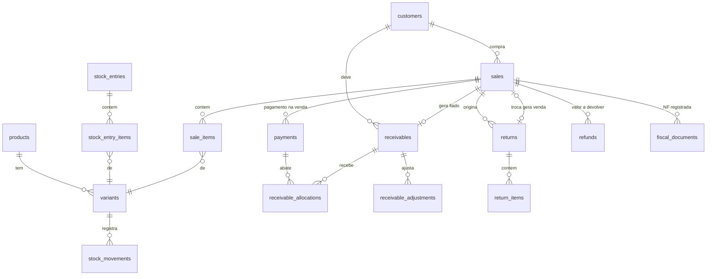

# 03 — Modelo de dados

PostgreSQL. Schema em Drizzle (`apps/api/src/db/schema/*.ts`). Migrations geradas e **commitadas**.
Extensões: `unaccent`, `pg_trgm` (busca por nome sem acento).

## 1. Glossário (interface pt-BR → código en)

| Interface | Código / tabela |
| --- | --- |
| Produto / modelo / peça | `Product` / `products` |
| Variação / combinação (cor + tamanho) | `Variant` / `variants` |
| Movimento de estoque | `StockMovement` / `stock_movements` |
| Entrada de mercadoria | `StockEntry` / `stock_entries` |
| Acerto / ajuste de estoque | movimento `type = 'adjustment'` |
| Importação de planilha | `ImportBatch` / `import_batches` |
| Cliente | `Customer` / `customers` |
| Venda / rascunho | `Sale` (`status = 'draft'`) / `sales` |
| Item da venda | `SaleItem` / `sale_items` |
| Pagamento / recebimento | `Payment` / `payments` |
| Fiado / dívida | `Receivable` / `receivables` |
| Abatimento da dívida | `ReceivableAllocation` (pagamento) / `ReceivableAdjustment` (cancelamento, devolução) |
| Devolução de valor (dinheiro de volta) | `Refund` / `refunds` |
| Devolução de peças / troca / retorno físico | `Return` / `returns`, `ReturnItem` / `return_items` |
| Fechamento do dia | `DailyClosing` / `daily_closings` |
| Nota fiscal registrada | `FiscalDocument` / `fiscal_documents` |
| Data do movimento (dia da loja) | `business_date` |

## 2. Diagrama (visão geral)

## 3. Tabelas

Convenções: `id uuid PK` (v7), `created_at timestamptz default now()`, `updated_at timestamptz` onde há edição.
`*_cents integer`. `business_date date`. Enums como `pgEnum`.

### 3.1 Acesso

**users** — `id`, `name`, `email` (unique, lower), `password_hash`, `created_at`, `updated_at`.

**sessions** — `id`, `user_id` FK, `token_hash` (unique), `user_agent`, `ip`, `expires_at`, `last_seen_at`, `created_at`.

**password_resets** — `id`, `user_id`, `token_hash` (unique), `expires_at`, `used_at`, `created_at`.

### 3.2 Configuração

**store_settings** (linha única, `id = 1`)

| Coluna | Tipo | Obs |
| --- | --- | --- |
| store_name | text not null | nome no comprovante |
| legal_name | text | razão social |
| cnpj | text | |
| state_registration | text | Inscrição Estadual **[A]** |
| uf, city | text | **[A]** — usados no aviso de envio interestadual |
| address, phone, email | text | comprovante |
| timezone | text not null default `'America/Sao_Paulo'` | **[A]** confirmar |
| tax_regime | enum `mei` \| `simples` \| `other` default `mei` | |
| receipt_footer | text | mensagem opcional no comprovante |
| fiscal_rules_validated | boolean not null default false | contador validou as regras (RN-FIS-07) |
| updated_at | timestamptz | |

### 3.3 Produtos

**products**

| Coluna | Tipo | Obs |
| --- | --- | --- |
| name | text not null | |
| reference | text | opcional |
| category | text | opcional, texto livre com sugestões |
| description | text | opcional |
| base_price_cents | integer not null CHECK ≥ 0 | preço padrão das variações |
| cost_cents | integer CHECK ≥ 0 | opcional |
| active | boolean default true | |

Índice: `gin (unaccent(lower(name)) gin_trgm_ops)` (ou função imutável wrapper de unaccent).

**variants**

| Coluna | Tipo | Obs |
| --- | --- | --- |
| product_id | uuid FK not null | |
| color | text not null | “Preta” |
| size | text not null | “M”, “38”, “U” |
| size_sort | integer not null | calculado por `shared/sizes.ts` |
| price_cents | integer CHECK ≥ 0 | **null = usa `base_price_cents`** |
| cost_cents | integer | opcional |
| sku | text | opcional |
| stock_qty | integer not null default 0 **CHECK ≥ 0** | saldo atual (cache do ledger) |
| min_stock | integer CHECK ≥ 0 | **null = sem alerta** (RN-EST-08) |
| active | boolean default true | |

`UNIQUE (product_id, lower(color), lower(size))`.

### 3.4 Estoque

**stock_movements** (ledger — só INSERT)

| Coluna | Tipo | Obs |
| --- | --- | --- |
| variant_id | uuid FK not null | |
| type | enum `initial` \| `purchase_entry` \| `sale` \| `sale_cancel_return` \| `return_in` \| `adjustment` | |
| quantity_delta | integer not null CHECK ≠ 0 | negativo = saída |
| balance_after | integer not null CHECK ≥ 0 | saldo depois do movimento |
| adjustment_reason | enum `count` \| `loss` \| `damage` \| `error` \| `other` | só `adjustment` |
| counted_qty | integer | só ajuste por contagem |
| note | text | |
| ref_type | enum `stock_entry` \| `sale` \| `return_item` \| `import` \| `manual` | |
| ref_id | uuid | |
| business_date | date not null | |
| created_by | uuid FK users | |

Índice único parcial anti-duplicidade:
`UNIQUE (ref_type, ref_id, variant_id, type) WHERE ref_type IN ('sale','return_item','import')`.

**stock_entries** — `entry_date date`, `supplier_name text`, `reference text`, `notes text`, `created_by`.
**stock_entry_items** — `entry_id FK`, `variant_id FK`, `quantity integer CHECK > 0`, `unit_cost_cents integer`.

**import_batches** — `file_name`, `status enum previewed|committed|discarded`, `preview jsonb` (linhas normalizadas + erros),
`summary jsonb` (produtos/variações/unidades), `created_by`, `committed_at`.

### 3.5 Clientes

**customers**

| Coluna | Tipo | Obs |
| --- | --- | --- |
| name | text not null | homônimos permitidos |
| phone | text | exibido junto ao nome para diferenciar |
| email | text | |
| notes | text | |
| document_type | enum `cpf` \| `cnpj` | opcional |
| document | text | só dígitos; `UNIQUE` parcial quando não nulo |
| address | jsonb | `{ zip, street, number, complement, district, city, uf }` opcional |
| active | boolean default true | |

### 3.6 Vendas

**sales**

| Coluna | Tipo | Obs |
| --- | --- | --- |
| number | integer unique | da sequence `sale_number_seq`, **atribuído na confirmação** |
| status | enum `draft` \| `confirmed` \| `cancelled` | |
| version | integer not null default 1 | concorrência otimista no rascunho |
| customer_id | uuid FK | obrigatório se houver fiado |
| customer_snapshot | jsonb | nome, telefone, documento no momento da confirmação |
| buyer_type | enum `consumer_pf` \| `company_pj` | definido na confirmação (RN-FIS-01) |
| subtotal_cents | integer not null | soma das linhas |
| discount_kind | enum `none` \| `amount` \| `percent` | |
| discount_value | integer | centavos (amount) ou pontos-base (percent) |
| discount_cents | integer not null default 0 | CHECK `0 ≤ discount_cents ≤ subtotal_cents` |
| total_cents | integer not null | CHECK `= subtotal − discount` e ≥ 0 |
| draft_payments | jsonb | só no rascunho: `[{ id, method, amountCents, confirmed, cardType?, installments? }]` |
| draft_fiado_due_date | date | só no rascunho |
| payment_status | enum `paid` \| `partially_paid` \| `unpaid` | cache, atualizado pelos services |
| shipping_status | enum `none` \| `pending` \| `shipped` \| `delivered` | default `none` |
| shipping_address | jsonb | mesmo formato do cliente |
| shipping_uf | text | para o alerta interestadual |
| tracking_code | text | texto livre |
| shipped_at, delivered_at | timestamptz | |
| fiscal_requirement | enum `not_required` \| `required` \| `review` | RN-FIS |
| fiscal_note | text | motivo exibido (“Cliente com CNPJ: NF-e obrigatória”) |
| fiscal_requested | boolean default false | cliente pediu nota (RN-FIS-05) |
| channel | text | **[A]** sem tela na v1 |
| notes | text | |
| origin_return_id | uuid FK returns | venda gerada por troca |
| confirmed_at | timestamptz | |
| business_date | date | dia da confirmação |
| cancelled_at, cancel_reason, cancelled_by | | |

**sale_items**

| Coluna | Tipo | Obs |
| --- | --- | --- |
| sale_id | FK | |
| variant_id | FK | |
| product_name | text | **snapshot** |
| variant_label | text | snapshot “Preta / M” |
| unit_price_cents | integer | preço efetivo da variação; no rascunho acompanha o cadastro, congelado na confirmação (não editável — RN-VEN-03, decisão 014) |
| quantity | integer CHECK > 0 | |
| line_subtotal_cents | integer | unit × qty |
| discount_allocated_cents | integer default 0 | rateio do desconto da venda (calculado na confirmação) |
| line_total_cents | integer | subtotal − rateio |
| returned_qty | integer default 0 | CHECK `≤ quantity`; inclui peças devolvidas **e** aguardando retorno |

`UNIQUE (sale_id, variant_id)` — mesma variação soma na linha existente.

### 3.7 Pagamentos e fiado

**payments** (só INSERT + anulação)

| Coluna | Tipo | Obs |
| --- | --- | --- |
| id | uuid | **= Idempotency-Key** enviada pelo front |
| kind | enum `sale_checkout` \| `receivable_receipt` \| `exchange_credit` | |
| method | enum `cash` \| `pix` \| `card` \| `exchange_credit` | `exchange_credit` não é dinheiro |
| card_type | enum `credit` \| `debit` | opcional |
| card_installments | integer | informativo **[A]** |
| amount_cents | integer CHECK > 0 | |
| sale_id | FK | em `sale_checkout` / `exchange_credit` |
| customer_id | FK | em `receivable_receipt` |
| business_date | date not null | dia do recebimento |
| received_at | timestamptz | |
| status | enum `valid` \| `voided` | |
| voided_at, void_reason, voided_by | | RN-FIA-07 |
| notes | text | |

**receivables** (dívidas do fiado)

| Coluna | Tipo | Obs |
| --- | --- | --- |
| customer_id | FK not null | |
| sale_id | FK | null quando `origin = previous_balance` |
| origin | enum `sale` \| `previous_balance` | |
| description | text | “Venda #000123” ou texto do saldo anterior |
| original_cents | integer CHECK > 0 | |
| paid_cents | integer default 0 | cache: soma das alocações de pagamentos `valid` |
| adjusted_cents | integer default 0 | cache: soma dos ajustes |
| balance_cents | integer **generated** `original − paid − adjusted` | CHECK ≥ 0 |
| due_date | date | opcional |
| status | enum `open` \| `settled` \| `cancelled` | |
| business_date | date | dia da origem |
| settled_at | timestamptz | |

**receivable_allocations** — `payment_id FK`, `receivable_id FK`, `amount_cents CHECK > 0`. `UNIQUE (payment_id, receivable_id)`.

**receivable_adjustments** — `receivable_id FK`, `amount_cents CHECK > 0`, `reason enum sale_cancelled|items_returned`,
`ref_type`, `ref_id`, `created_at`.

**refunds** (valor a devolver à cliente)

| Coluna | Tipo | Obs |
| --- | --- | --- |
| id | uuid | idempotency key na criação |
| sale_id | FK | |
| source | enum `cancellation` \| `return` | |
| source_id | uuid | venda (cancelamento) ou return |
| amount_cents | integer CHECK > 0 | |
| status | enum `pending` \| `done` \| `cancelled` | |
| method | enum `cash` \| `pix` \| `card` | informado ao marcar `done` |
| done_at | timestamptz | |
| business_date | date | **dia em que foi efetivamente devolvido** |
| notes, cancel_reason | text | |

### 3.8 Devoluções, trocas e retorno físico

**returns**

| Coluna | Tipo | Obs |
| --- | --- | --- |
| sale_id | FK not null | venda original |
| type | enum `cancellation` \| `partial_return` \| `exchange` | |
| status | enum `awaiting_items` \| `completed` | completed quando todos os itens foram recebidos |
| reason | text | |
| items_value_cents | integer | valor (líquido de desconto) das peças devolvidas |
| applied_to_receivable_cents | integer default 0 | quanto abateu de fiado em aberto |
| refund_cents | integer default 0 | quanto virou devolução de valor |
| exchange_credit_cents | integer default 0 | quanto foi usado na venda de troca |
| exchange_sale_id | FK sales | |
| business_date | date | |

**return_items**

| Coluna | Tipo | Obs |
| --- | --- | --- |
| return_id | FK | |
| sale_item_id | FK | |
| variant_id | FK | |
| quantity | integer CHECK > 0 | |
| status | enum `awaiting` \| `received` | |
| condition | enum `sellable` \| `damaged` | ao receber |
| received_at | timestamptz | |

### 3.9 Fechamento e fiscal

**daily_closings** — `business_date date PK`, `expected_cash_cents`, `counted_cash_cents`, `difference_cents`,
`snapshot jsonb` (todos os totais exibidos), `notes`, `closed_at`, `closed_by`.

**fiscal_documents**

| Coluna | Tipo | Obs |
| --- | --- | --- |
| sale_id | FK not null | |
| doc_type | enum `nfe` \| `nfce` \| `nfa_e` \| `other` | |
| number, series | text | |
| access_key | text | 44 dígitos, validar formato |
| issued_at | date | |
| status | enum `registered` \| `cancel_pending` \| `cancelled` | `registered` = a dona informou que foi autorizada no emissor externo |
| notes | text | |

### 3.10 Auditoria

**audit_log** — `entity`, `entity_id`, `action`, `before jsonb`, `after jsonb`, `reason`, `user_id`, `created_at`.

## 4. Invariantes (testar e ter script de verificação)

`bun run scripts/check-integrity.ts` deve verificar e relatar:

1. `variants.stock_qty = Σ stock_movements.quantity_delta` por variação.
2. `receivables.paid_cents = Σ allocations` de pagamentos `valid`; `adjusted_cents = Σ adjustments`; `balance ≥ 0`.
3. Venda `confirmed`: `total_cents = Σ payments sale_checkout/exchange_credit válidos na confirmação + receivable.original_cents`.
4. `sale_items.returned_qty = Σ return_items.quantity` do item.
5. Toda venda `confirmed` tem movimento `sale` para cada item; nenhuma tem dois.
6. `sales.payment_status` coerente com o receivable.
